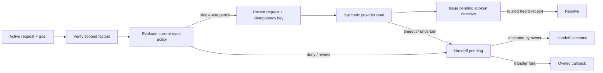

# Authority-Gated Call Resolution Core

This is an extracted TypeScript runtime slice for a request that needs more than a plausible reply: current verification, a parameter-bound authorization, durable workflow state, provider reconciliation, audible completion evidence, and an owned human fallback.

It is actual implementation code and its original offline integration test, exported with generic synthetic fixtures. The package includes a PostgreSQL workflow repository and schema contract, alongside in-memory repositories used by the offline tests. It includes no database client, connection configuration, credentials, hosted configuration, call recordings, transcripts, contact details, or phone/SMS provider adapter.

## The control flow



The code deliberately separates three claims that are often incorrectly collapsed:

1. An action was authorized for this request, subject, parameters, and state version.
2. A provider returned a verified readback.
3. The caller-facing directive was actually acknowledged as heard.

A terminal answer requires all applicable evidence; a transfer remains pending until an owner accepts it.

## Run the actual offline suite

Requires Node 22+ and pnpm 11+.

```sh
pnpm install --frozen-lockfile --ignore-scripts
pnpm test
pnpm typecheck
```

The included test suite has 22 offline cases. It uses in-memory authority, repository, protected-content, heard-receipt, and synthetic-provider fakes. It does not make network, speech, model, database, or provider calls.

The cases cover, among other boundaries:

- stale state blocking a provider read;
- parameter-bound, single-use permit consumption;
- persistence of an idempotency key before provider work;
- rejecting forged or replayed heard receipts;
- identity expiry and subject mismatch;
- unresolved provider work remaining owned for reconciliation;
- explicit/repeated-failure handoff, accepted handoff, and failed-transfer callback ownership;
- direct-adapter bypass rejection and aggregate-memory redaction.

## Package layout

| Path | Actual component | Offline role in this export |
|---|---|---|
| `packages/contracts` | Typed state, permit, event, and workflow contracts | Validates state shape and allowed transitions. |
| `services/control-plane` | Current-state policy and permit authority | Issues and consumes scoped permits against an in-memory repository. |
| `packages/intergy-simulator` | Stateful synthetic provider adapter | Exercises parameter binding, idempotency, receipts, readback, and controlled failures without a live provider. |
| `services/call-orchestrator` | Appointment-details orchestration | Coordinates verification, policy, protected evidence, readback, spoken-directive state, and handoff recovery. |

## Export boundary

This repository is a portable core, not the full runtime. Deliberately excluded:

- database drivers, live connections, deployment migrations and connection configuration; the workflow repository and schema contract are retained, with a small offline pool type stub;
- any telephony, speech, SMS, model, webhook, or network adapter;
- client-specific practice facts, raw evidence, identifiers, operational records, and deployment material;
- authentication, tenant management, actual human-routing infrastructure, and live provider integration.

The retained interfaces show where those boundaries attach, but this export cannot place or receive a call, deliver a message, look up a real record, or prove live audio/model behavior. Passing the offline suite demonstrates the checked state and authority mechanics only; it does not establish production readiness or business outcomes.

## Fixture note

All fixture identifiers, appointment labels, and timestamps in this export are generic synthetic values. They were redacted from the source fixture/test literals while preserving the original control-flow assertions.
