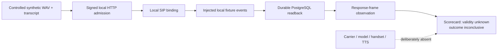

# Voice + SMS Operations: Offline Benchmark Slice

This repository contains the original authority-gated operations core plus a source-authentic, sanitized offline voice-receptionist fixture. It is designed to make a narrow claim reproducible: a controlled synthetic input can pass through signed local admission, local SIP binding, durable PostgreSQL readback, and a response-frame observation without contacting a carrier, model, speech provider, or external network.

It is not a production voice demo and it makes no claim that a caller bridge, handset audio, ASR, model reasoning, TTS, transfer, callback, SMS delivery, or cost was verified.

## What the offline benchmark proves



The fixture never dials, sends an SMS, records a call, or calls a provider endpoint. Local `fetch` is restricted by the harness to loopback HTTP. The synthetic WAV is one second of silence paired with a generic scheduling transcript; it is a supplied input, not ASR evidence.

## Run it locally

Requirements: Node 22+, pnpm 11+, and PostgreSQL command-line tools (`initdb`, `pg_ctl`, `psql`) on `PATH`. The fixture creates and removes a local loopback PostgreSQL cluster; it does not need a database server or credentials.

```sh
pnpm install --frozen-lockfile --ignore-scripts
pnpm test
pnpm typecheck
```

Expected result: 36 passing tests. This includes the original 22 core authority tests, 10 local signed-admission/SIP/PostgreSQL harness tests, and 4 scorecard tests.

The harness deliberately treats its own joined evidence as lower tier:

- `validity: "unknown"`
- `outcome: "inconclusive"`
- no goals graded as completed, accepted transfer, or owned callback
- null model, tool, latency, and cost fields

A scorecard pass requires valid evidence and terminally owned goals. A saved message alone is not an owned callback; a connected carrier leg alone is not an accepted transfer.

## Package layout

| Path | Role |
| --- | --- |
| `services/call-orchestrator` | Original 22-case authority and workflow core. |
| `scripts/verification-voice-app.ts` | Existing local evaluation harness for signed admission, SIP binding, and durable readback. |
| `benchmarks/voice-receptionist/src` | Scorecard and intentionally inconclusive local-fixture adapter. |
| `benchmarks/voice-receptionist/fixtures/synthetic` | Reserved synthetic silence WAV and generic transcript. |
| `services/process-shell` | Actual receptionist composition dependency closure, redacted only for practice identity and endpoints. |

## Public-export boundary and provenance

This is a sanitized, source-authentic dependency slice, not a replay of a private deployment. The control flow and dependency graph are retained; only client/practice labels, location facts, direct-demo endpoints, and private source-history identifiers are mechanically replaced with generic synthetic values.

`benchmarks/voice-receptionist/PUBLIC_EXPORT_MANIFEST.json` records public artifact identities and content digests. It intentionally contains no private parent commit IDs, private source paths, original transform map, client records, recordings, raw transcripts, credentials, or private configuration.

Excluded by design: provider credentials, phone/SMS numbers other than reserved synthetic test values, client names and facts, recordings, real caller audio, raw transcripts, private run outputs, caches, private git history, and all deployment material.

## Limits

A passing local test suite means the exported local fixture and core control mechanics ran. It does **not** establish operational effectiveness, production readiness, or improvement over a private baseline. For that, a separately authorized evaluation needs a causally joined caller bridge and appropriate evidence for every claimed tier.
