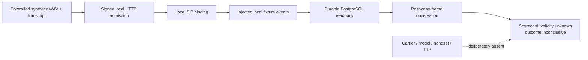

# Voice + SMS Operations

A caller can finish a conversation while the work they asked for is still sitting unowned. I built this system to track the request, the action behind it, and the person responsible for the next step.

This repo contains the TypeScript operations core and staff dashboard from that system. The dashboard shows conversation queues, request ownership, follow-up activity and evidence of what happened. The operations core checks permissions and reads back provider state before recording completion.

## See the dashboard

The quickest way to inspect the UI is the [committed preview](docs/staff-dashboard-preview.html): download it and open it in a browser. It uses fictional data and doesn't connect to a customer system.

To generate it yourself, use Node 22+ and pnpm 11+:

```sh
pnpm install --frozen-lockfile --ignore-scripts
pnpm dashboard:preview
```

Open `staff-preview.html`. This runs the actual renderer, but the preview is static: scripts, forms and network access are disabled. It doesn't make calls or send messages. The [dashboard guide](docs/STAFF-DASHBOARD.md) links the renderer, browser client and authenticated staff handler.

## Check the software

The dashboard checks don't need PostgreSQL or a provider account:

```sh
pnpm dashboard:test
pnpm typecheck
```

For the full offline suite, put PostgreSQL command-line tools (`initdb`, `pg_ctl`, `psql`) on `PATH`, then run:

```sh
pnpm test
```

The fixture starts and removes its own loopback PostgreSQL cluster. It doesn't need credentials or an existing database server. The suite contains 97 tests across the operations core, signed admission/SIP/PostgreSQL fixture, scorecard and dashboard. See the [verification receipt](docs/VERIFICATION.md) for actual results and environment limits, rather than treating the test count as a pass claim.

## Voice evaluation slice

The offline voice fixture checks signed local admission, local SIP binding, durable PostgreSQL readback and response-frame observation using controlled synthetic input. It never contacts a carrier, model or speech provider.

A live phone demo needs the private deployment and separately authorized services. This fixture does not verify caller audio, ASR, model reasoning, TTS, transfer, callback or SMS delivery.

## What the offline benchmark proves



The fixture never dials, sends an SMS, records a call, or calls a provider endpoint. Local `fetch` is restricted by the harness to loopback HTTP. The synthetic WAV is one second of silence paired with a generic scheduling transcript; it is a supplied input, not ASR evidence.

The harness deliberately treats its own joined evidence as lower tier:

- `validity: "unknown"`
- `outcome: "inconclusive"`
- no goals graded as completed, accepted transfer, or owned callback
- null model, tool, latency, and cost fields

A scorecard pass requires valid evidence and terminally owned goals. A saved message alone is not an owned callback; a connected carrier leg alone is not an accepted transfer.

## Package layout

| Path | Role |
| --- | --- |
| `services/call-orchestrator` | Original 22-case authority and workflow core. |
| `scripts/verification-voice-app.ts` | Existing local evaluation harness for signed admission, SIP binding, and durable readback. |
| `benchmarks/voice-receptionist/src` | Scorecard and intentionally inconclusive local-fixture adapter. |
| `benchmarks/voice-receptionist/fixtures/synthetic` | Reserved synthetic silence WAV and generic transcript. |
| `services/process-shell` | Actual receptionist composition dependency closure, redacted only for practice identity and endpoints. |

## Public-export boundary and provenance

This is a sanitized, source-authentic dependency slice, not a replay of a private deployment. The control flow and dependency graph are retained; only client/practice labels, location facts, direct-demo endpoints, and private source-history identifiers are mechanically replaced with generic synthetic values.

`benchmarks/voice-receptionist/PUBLIC_EXPORT_MANIFEST.json` records public artifact identities and content digests. It intentionally contains no private parent commit IDs, private source paths, original transform map, client records, recordings, raw transcripts, credentials, or private configuration.

Excluded by design: provider credentials, phone/SMS numbers other than reserved synthetic test values, client names and facts, recordings, real caller audio, raw transcripts, private run outputs, caches, private git history, and all deployment material.

## Limits

A passing local test suite means the exported local fixture and core control mechanics ran. It does **not** establish operational effectiveness, production readiness, or improvement over a private baseline. For that, a separately authorized evaluation needs a causally joined caller bridge and appropriate evidence for every claimed tier.
