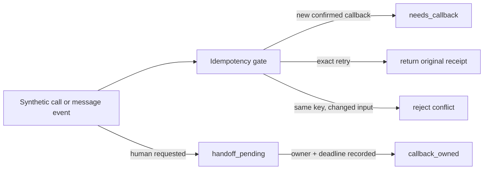

# Voice/SMS Operations: Offline State Replay

A small, dependency-free replay of three controls that matter when an automated call or message creates work for a human team:

- a callback request becomes actionable only after a synthetic confirmation event supplies its required fields;
- an idempotency key safely returns the original receipt on an exact retry and rejects changed input under the same key;
- a handoff is pending until a synthetic owner and follow-up window are recorded.

The code uses fictional request data only. It does not call a phone provider, send an SMS, use speech recognition, call a model, or connect to a client system.

## What it demonstrates



The point is not the wording of a message. It is the state boundary: a request is not treated as finished merely because automation captured text, and a transfer is not treated as complete until ownership is explicit.

## Run

Requires Python 3.9+ and the standard library only.

```sh
python3 replay.py --scenario confirmation
python3 replay.py --scenario handoff
python3 -m unittest discover -s tests -v
```

## Example: confirmation and replay

The confirmation scenario assumes a fictional caller has already confirmed the details; the synthetic input carries that confirmation event. The replay validates only required nonblank fields and idempotency. It does not listen to, interpret, or infer confirmation from a conversation.

The fictional callback request is:

```text
idempotency key: synthetic-confirm-v1
message: "Please return my call about an upcoming visit."
callback window: "weekday afternoon"
```

It produces three deliberately different results:

```json
{
  "first": {"status": "saved", "state": "needs_callback", "replayed": false},
  "exact_replay": {"status": "saved", "state": "needs_callback", "replayed": true},
  "changed_replay": {
    "status": "conflict",
    "detail": "idempotency_key_reused_with_different_input"
  }
}
```

The changed retry does not overwrite the saved synthetic request.

## Example: handoff ownership

```text
synthetic reason: caller_requested_person
synthetic owner: synthetic-queue
follow-up window: within one business day
```

The initial result is `handoff_pending`. It becomes `callback_owned` only after the owner and window are supplied. An empty owner or deadline is rejected without moving the request forward.

## Relationship to the underlying work

This is a deliberately reduced, offline showcase of state-management patterns used in a larger voice/SMS operations implementation: persisted request state, idempotent commands, confirmation before a follow-up queue, and explicit handoff ownership. It is not that implementation, a deployment artifact, or a live demo.

The full implementation has additional boundaries that this showcase does not reproduce, including authentication, authorization, tenant scoping, provider receipts, durable storage, delivery attempts, and voice/audio behavior.

## Limits

- The replay stores state in memory and resets each run.
- It has no real identity verification, consent, scheduling, routing, queue, delivery, or callback capability.
- Its `owner` field is a fictional stand-in, not proof that a person accepted a real handoff.
- It makes no claim about speech accuracy, model performance, delivery success, response times, staffing effects, or business outcomes.

The value of this export is inspectable control flow, not a claim that an offline simulation validates a live voice system.
